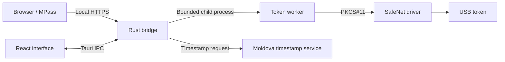
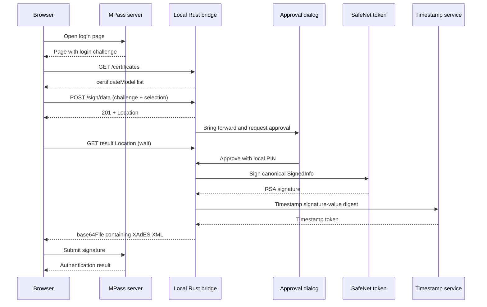

# Architecture

MoldSign Bridge has three local layers: the React interface, the Rust bridge service, and isolated token workers. MPass and Moldova’s timestamp service are the external participants.

## Frontend

React and TypeScript render the connection screen and approval dialog. Vite builds the frontend into `dist/`; Tauri embeds those assets in the macOS app.

`hooks/use_bridge.ts` manages initialization, status polling, token scans, and approval actions. It prevents overlapping status polls and guards concurrent actions. The typed `lib/bridge_client.ts` is the frontend’s entry point to Tauri commands.

The PIN form uses an uncontrolled input ref. The PIN is not stored in React state. A new request mounts a fresh form; submission, cancellation, and removal of the form clear or discard its input. The shared dialog primitive opens a native HTML modal and focuses its designated input after opening.

## Rust bridge

`src-tauri/src/bridge.rs` owns the HTTPS listener and request lifecycle. It binds to IPv4 loopback on port `18443`. A browser request must use the expected hostname and MPass origin.

The in-memory state holds certificate models from a local scan and at most one login operation. The browser selects a cached certificate by ID; it cannot substitute its own certificate bytes for signing. Operations have random IDs and a two-minute lifetime. Results are consumed once and are not written to a history database.

On a new login request, the bridge restores the main window, sets it temporarily always on top, and focuses it. Signing completion, cancellation, and expiry release the topmost setting.

## Token processes

The app executable has dedicated worker modes:

| Mode                   | Purpose                                   | Limit             |
| ---------------------- | ----------------------------------------- | ----------------- |
| `--probe-token`        | Enumerate public token certificates       | 20 seconds        |
| `--sign-token`         | Log in once and produce a signature       | 25 seconds        |
| `--token-capabilities` | Report supported RSA signing capabilities | Manual diagnostic |

The driver is dynamically loaded inside the worker. A stalled or crashed driver therefore does not run on the UI thread. Probe output is bounded; signing input is bounded and supplied through stdin. The signer logs out after the operation and exits. There is no cached PIN session.

The signing worker matches the certificate’s `CKA_ID` to a private key, creates the RSA signature, and verifies it against the certificate before returning it. [MPass protocol](mpass_protocol.md) explains the signing mechanism and XML envelope.

## Login sequence

MPass’s response is the final authentication result. Local signature creation alone does not establish browser login.

## Files and persistence

Only the local HTTPS certificate/key pair is intentionally persisted by the connection flow. Certificate models, pending challenges, PIN input, and signature results are handled in memory or worker pipes. OS memory, crash handling, and vendor middleware are separate from this app’s guarantees; see [Security](security.md).

[Documentation index](index.md)

The app identifier is `dev.basicshapes.moldsign-bridge`. Startup migrates a complete legacy local HTTPS identity into the new app-data location using a restricted staging directory and atomic rename. Existing destination directories are never replaced. The legacy identity remains available for rollback.
